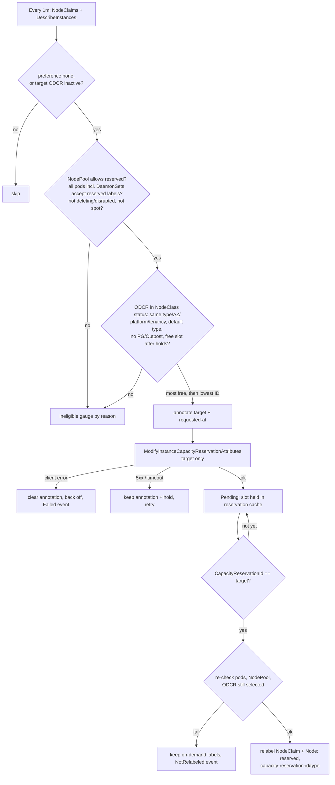
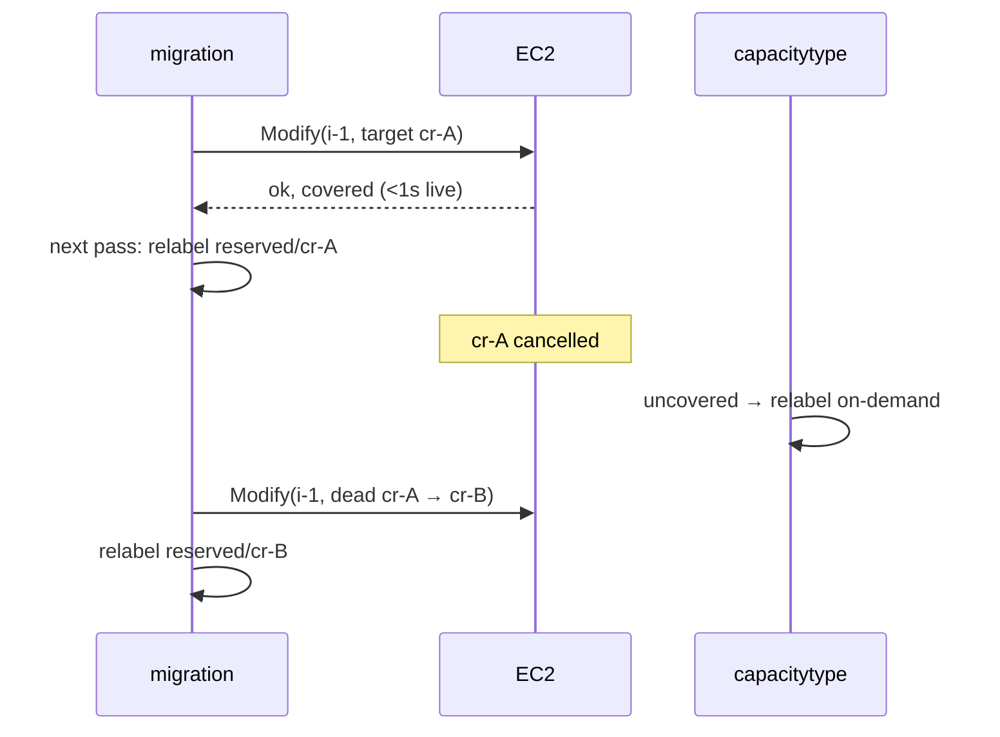

# In-Place ODCR Migration

## Summary

Karpenter moves running on-demand nodes, and nodes whose ODCR expired, into a free ODCR their EC2NodeClass selects, without draining or replacing them. It uses EC2's ability to change the Capacity Reservation settings of a running instance ([docs](https://docs.aws.amazon.com/AWSEC2/latest/UserGuide/capacity-reservations-modify-instance.html), Nov 20 2026). The feature ships as alpha behind the `ReservedCapacityMigration` AWS feature gate, which is off by default and also requires `ReservedCapacity`. It closes the last gap before native ODCR support goes GA (#7979, #9518 in part).

## Motivation

With `ReservedCapacity` on, Karpenter launches:
- reserved nodes with `capacity-reservations-only` + a target ODCR
- every other node with preference `none`

Until now that choice was fixed at launch. So customers end up with idle ODCRs next to on-demand nodes that could have filled them:
- when a new ODCR is added
- when slots free up
- when a targeted ODCR expires and its nodes are orphaned

The only remedy was consolidation (terminate and relaunch). do-not-disrupt, long jobs and scarce instance types block it, so some users turn `ReservedCapacity` off and give up ODCR prioritization.

**Goals**
- Fill free ODCR slots with existing nodes, with no disruption.
- Keep the `reserved` label honest: a node is labeled reserved only once EC2 reports coverage.
- Never violate NodePool requirements or pod constraints.

**Non-goals**
- Moving a node between two live ODCRs, or back to `none`. EC2 doesn't support this for running instances.
- Open-preference instances, Capacity Blocks, interruptible ODCRs, capacity reservation groups.
- Creating an ODCR from a running instance (#9518 when the pool is exhausted).

## Proposal

A singleton controller, `capacityreservation.migration`, runs every 1m. EC2 allows two transitions on a running instance, and the controller uses only these:

| Case | Instance today | Transition |
|---|---|---|
| (a) on-demand | preference `none` | → target an active ODCR |
| (b) orphaned | targets an ODCR that's no longer active | → target an active ODCR |

## Design Details

- **State:** two annotations, `karpenter.k8s.aws/capacity-reservation-migration-target` and `-requested-at`. They make the controller restart-safe. EC2's view of the instance is the source of truth.
- **No double-booking:** pending migrations hold slots in the reservation cache, so neither the provisioner nor a second migration takes them.
- **Classification:** an instance whose target equals its covering ODCR is `reserved`, independent of the gate. Migration is one-way, so turning the gate off must not demote nodes. This was found in live testing.
- **Errors:** client errors such as `IncorrectInstanceState` are definite: clear the annotation, back off. 5xx, timeouts and resets are ambiguous: keep the hold and reconcile. After a crash between the annotation and the call, the call is re-issued only after a 5m visibility grace. A node that stays pending past 30m gets a `Stalled` event.
- **IAM:** `ec2:ModifyInstanceCapacityReservationAttributes`, scoped to instances tagged with the cluster and a NodePool. The getting-started CloudFormation template and docs are updated.

## Customer Experience (gate on)

| Area | Change |
|---|---|
| Availability | None: no drain, replacement or restart (live: same boot ID and pod UIDs). |
| Cost | Idle ODCR slots are absorbed by running on-demand nodes, raising ODCR utilization and cutting on-demand spend. |
| Capacity | Existing nodes take free slots before new launches. A pod that would have used the slot launches on-demand with the same instance type. |
| One-way | A migrated instance stays pinned to its ODCR until replaced. If that ODCR ends, the node becomes case (b) and moves again. |
| Labels | `capacity-type` flips `on-demand` → `reserved` on a running node. Pods that later require on-demand won't schedule there. |
| Observability | Metrics `karpenter_capacity_reservation_migration_{attempts_total{case,result}, completed_total{case}, pending, stalled, ineligible{reason}, coverage_duration_seconds}`. NodeClaim events `CapacityReservationMigration{Started,Completed,Failed,Stalled,NotRelabeled}`. Ineligibility is a gauge, not events, to avoid spam. |

## Compatibility with Existing Functionality

| Area | Behavior / gotcha |
|---|---|
| Provisioning | Holds shrink the reserved offerings the scheduler sees, avoiding `ReservedCapacityExceeded`. Migration and new launches compete for the same slot; first one wins. |
| Consolidation | A migrated node is priced as reserved (≈$0), so consolidation stops replacing it and may pack pods onto it. Nodes tainted `karpenter.sh/disrupted` are skipped. |
| Drift | Targets come only from NodeClass status, so `CapacityReservationDrift` stays false. **Gotcha (D5):** in a reserved-only NodePool, an orphaned node is relabeled on-demand and may be replaced by requirement drift before migration (1m) saves it. |
| capacitytype controller | Now lists NodeClaims before instances, so a stale snapshot can't undo a fresh relabel. |
| Expiration | Only Capacity Blocks near their end are deleted, and they're never migration targets. |
| DRA | Unchanged. Only labels change; devices and ResourceSlices are untouched. |
| Spot / open / Capacity Block / interruptible | Never migrated. EC2 also rejects open → target, and Capacity Block or interruptible targets. |

## Testing

Unit tests cover the eligibility matrix, ODCR selection, crash and lag recovery, error classification, cache holds, the capacitytype ordering, the drift guard, and gate-off classification. Live tests ran on EKS 1.34 in eu-central-1 with real ODCRs:

| Scenario | Result |
|---|---|
| On-demand node, then a matching ODCR is created | Re-targeted ~80s later, relabeled the next pass; same instance |
| Pod requires on-demand / NodePool allows on-demand only | Both skipped, no EC2 call |
| ODCR cancelled, then a new one created | Demoted in 32s, migrated to the new ODCR ~60s later |
| Gate off | No migration in 21 min |
| Gate turned off after migration | Found the demotion bug; fixed and re-verified |

## Graduation Plan

Native ODCR support (`ReservedCapacity`, Beta) graduates to GA only once in-place migration works by default.

| Step | Change |
|---|---|
| 1. This PR | Migration lands as alpha (`ReservedCapacityMigration`, off by default) for opt-in validation. |
| 2. Before GA | Resolve D5 (drift race) and D6 (opt-in scope); add migration e2e suites. |
| 3. GA PR | Migration on by default, and `ReservedCapacity` promoted to stable, together. |

## Open Questions

- **D3:** should *preferred* on-demand affinity block migration? Current answer: no; only required rules block it.
- **D5:** hold off drift for orphaned nodes in reserved-only NodePools while a free selected ODCR exists? Proposed follow-up before beta.
- **D6:** for a one-way change, is a global gate enough, or is a per-NodePool annotation or an EC2NodeClass field needed? A field is likely required for Auto Mode.
- **GA:** what happens to the `ReservedCapacity` gate, and to users running with it off (open matching)?

## Alternatives

**Open matching:** launch non-reserved nodes with preference `open`.
*Why not?* The `reserved` label would no longer be guaranteed. Open ODCRs could be used by NodePools that disallow reserved. Pod-level ODCR constraints couldn't be enforced.

**Capacity reservation group per NodeClass:** EC2 places instances into the group's ODCRs.
*Why not?* There's a regional resource-group limit. The `capacity-reservation-id` scheduling label would be dropped. Group membership changes would still need drift.

**Do nothing (consolidation):** *Why not?* Consolidation disrupts workloads, and it's blocked exactly where customers care most: do-not-disrupt pods, long jobs and scarce capacity.
