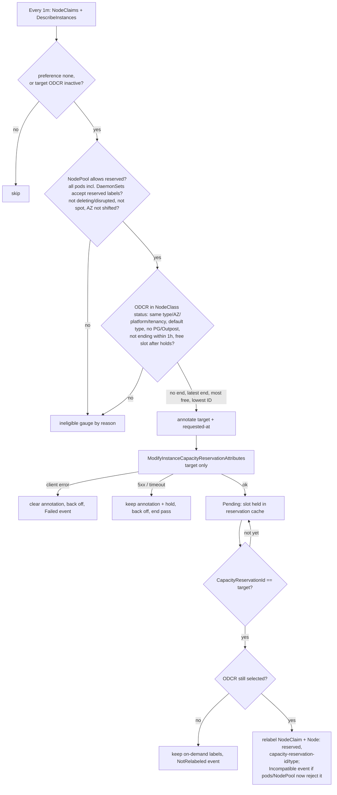

# In-Place ODCR Migration

## Summary

Karpenter moves running on-demand nodes, and nodes whose ODCR expired, into a free ODCR their EC2NodeClass selects, without draining or replacing them. It uses EC2's ability to change the Capacity Reservation settings of a running instance ([docs](https://docs.aws.amazon.com/AWSEC2/latest/UserGuide/capacity-reservations-modify-instance.html)). The feature ships as alpha behind the `ReservedCapacityMigration` AWS feature gate, which is off by default and also requires `ReservedCapacity`. It removes the main reason ODCR users fall back to consolidation or open matching (#7979, #9518 in part).

## Motivation

With `ReservedCapacity` on, Karpenter launches:
- reserved nodes with `capacity-reservations-only` + a target ODCR
- every other node with preference `none`

Until now that choice was fixed at launch. So customers end up with idle ODCRs next to on-demand nodes that could have filled them:
- when a new ODCR is added
- when slots free up
- when a targeted ODCR expires and its nodes are orphaned

The only remedy was consolidation (terminate and relaunch). do-not-disrupt, long jobs and scarce instance types block it, so some users turn `ReservedCapacity` off and give up ODCR prioritization.

**Goals**
- Fill free ODCR slots with existing nodes, with no disruption.
- Keep the `reserved` label honest: a node is labeled reserved only once EC2 reports coverage.
- Never violate NodePool requirements or pods' required node affinity. Topology spread and pod (anti-)affinity keyed on capacity-type or reservation-id aren't checked.

**Non-goals**
- Moving a node between two live ODCRs, or back to `none`. EC2 doesn't support this for running instances.
- Open-preference instances, Capacity Blocks, interruptible ODCRs, capacity reservation groups.
- Creating an ODCR from a running instance (#9518 when the pool is exhausted).

## Proposal

A singleton controller, `capacityreservation.migration`, runs every 1m. EC2 allows two transitions on a running instance, and the controller uses only these:

| Case | Instance today | Transition |
|---|---|---|
| (a) on-demand | preference `none` | → target an active ODCR |
| (b) orphaned | targets an ODCR that's no longer active | → target an active ODCR |



```mermaid
sequenceDiagram
  participant M as migration
  participant EC2
  participant CT as capacitytype
  M->>EC2: Modify(i-1, target cr-A)
  EC2-->>M: ok, covered (seconds; up to ~8 min live)
  M->>M: next pass: relabel reserved/cr-A
  Note over EC2: cr-A cancelled
  CT->>CT: uncovered → relabel on-demand
  M->>EC2: Modify(i-1, dead cr-A → cr-B)
  M->>M: relabel reserved/cr-B
```

## Design Details

- **State:** two annotations, `karpenter.k8s.aws/capacity-reservation-migration-target` and `-requested-at`. They make the controller restart-safe. The target stays after completion as a marker, so a demotion from stale EC2 data is relabeled again. EC2's view of the instance is the source of truth.
- **No double-booking:** pending migrations hold slots in the reservation cache, so neither the provisioner nor a second migration takes them. A covered node stays held until a sync whose API call *started* after the DescribeInstances sweep that showed it covered (none if one already did), at most 15m, or until the count is forced from EC2 (`SetAvailableInstanceCount`). Every hold, including draining and out-of-band ones, ends after the 30m stall threshold or once EC2 targets another ODCR. Migration also leaves slots for reserved NodeClaims that haven't launched (one per offered ODCR).
- **Classification and labels:** an instance whose target equals its covering ODCR is `reserved`, independent of the `ReservedCapacityMigration` gate. Labels follow EC2: once covered by a selected ODCR, the node is labeled `reserved` even if a pod or the NodePool started rejecting it while pending (`Incompatible` event; requirement drift handles the NodePool case). If the gate is turned off while a move is pending, the capacitytype controller completes it from the target annotation, so Delete returns the slot to the right ODCR; it never relabels re-targets the migration controller didn't start. Coverage by an unselected ODCR stays `on-demand`, as with open matching, so it can't cause `CapacityReservationDrift` unless EC2 reports `capacity-reservations-only` and there's no migration marker. An adoption already covered isn't counted as a migration (no metrics or `Completed` event), but is held like any coverage.
- **Target choice:** ODCRs ending within 1h are skipped (coverage can take up to the 30m stall threshold); then no end date, latest end, most free slots, lowest ID.
- **Errors:** client errors such as `IncorrectInstanceState` or `RequestExpired` are definite: clear the annotation, back off. `UnauthorizedOperation` backs off that instance for that ODCR (5m doubling to 1h), and the whole ODCR for 5m once a second instance is denied, since the shipped policy scopes the permission by instance tags. `IncorrectInstanceState` saying only stopped instances are allowed means the Region doesn't support it yet: pause all migration for 1h, doubling to 6h, with one log and no events. 5xx, timeouts and resets are ambiguous: keep the annotation and hold, back off, and end the pass. After a crash between the annotation and the call, the call is re-issued only after a 5m visibility grace. A node that stays pending past 30m gets a `Stalled` event and releases its hold. Instances in a zonally shifted AZ are skipped before annotating.
- **IAM:** `ec2:ModifyInstanceCapacityReservationAttributes`, scoped to instances tagged with the cluster and a NodePool. The getting-started CloudFormation template and docs are updated.

## Customer Experience (gate on)

| Area | Change |
|---|---|
| Availability | None: no drain, replacement or restart (live: same boot ID and pod UIDs). |
| Cost | Idle ODCR slots are absorbed by running on-demand nodes, raising ODCR utilization and cutting on-demand spend. |
| Capacity | Existing nodes take free slots before new launches. A pod that would have used the slot launches on-demand with the same instance type. |
| One-way | A migrated instance stays pinned to its ODCR until replaced. If that ODCR ends, the node becomes case (b) and moves again; past a limited EndDate it isn't drifted while EC2 still covers it. |
| Labels | `capacity-type` flips `on-demand` → `reserved` on a running node. Pods that later require on-demand won't schedule there. |
| Observability | Metrics `karpenter_capacity_reservation_migration_{attempts_total{case,result}, completed_total{case}, pending, stalled, ineligible{reason}, coverage_duration_seconds}`. NodeClaim events `CapacityReservationMigration{Started,Completed,Failed,Stalled,NotRelabeled,Incompatible}`. Ineligibility is a gauge, not events, to avoid spam. |

## Compatibility with Existing Functionality

| Area | Behavior / gotcha |
|---|---|
| Provisioning | Holds shrink the reserved offerings the scheduler sees, avoiding `ReservedCapacityExceeded`. Migration and new launches compete for the same slot; first one wins. |
| Consolidation | A migrated node is priced as reserved (≈$0), so consolidation stops replacing it and may pack pods onto it. Nodes tainted `karpenter.sh/disrupted` are skipped. |
| Drift | Targets come only from NodeClass status, so `CapacityReservationDrift` stays false. **Gotcha (D5):** in a reserved-only NodePool, an orphaned node is relabeled on-demand and may be replaced by requirement drift before migration (1m) saves it. |
| capacitytype controller | Lists NodeClaims before instances, so a stale snapshot can't undo a fresh relabel. Also completes annotated moves when the gate is off, keeps Node labels in line with their NodeClaim. The interruptible label is a reserved-capacity label, so demotion and core `InstanceTypeNotFound` drift ignore it. |
| Rollback | Versions without the target-equals-covering classification demote migrated nodes but keep `interruptible=false`, so `InstanceTypeNotFound` drift replaces them in any NodePool, and DaemonSets requiring `reserved` lose pods. Documented with a workaround; backporting is a follow-up. |
| Expiration | Only Capacity Blocks near their end are deleted, and they're never migration targets. |
| DRA | Unchanged. Only labels change; devices and ResourceSlices are untouched. |
| Scheduling | Only pods already bound are checked. A DaemonSet or pending pod whose required affinity matches only after the relabel can preempt pods on a full node or stay Pending. Documented. |
| Spot / open / Capacity Block / interruptible | Never migrated. EC2 also rejects open → target, and Capacity Block or interruptible targets. |

## Testing

Unit tests cover the eligibility matrix, ODCR selection, crash and lag recovery, error classification, cache holds (incl. un-launched NodeClaims), label convergence with the gate turned off mid-migration, the drift guard, and version-skew classification. E2E specs (`needs:capacity-reservation`) cover in-place migration, an on-demand-only pod, and an orphaned node. Live tests ran on EKS 1.34 in eu-central-1 with real ODCRs:

| Scenario | Result |
|---|---|
| On-demand node, then a matching ODCR is created | Re-targeted ~80s later, relabeled the next pass; same instance |
| Pod requires on-demand / NodePool allows on-demand only | Both skipped, no EC2 call |
| ODCR cancelled, then a new one created | Demoted in 32s, migrated to the new ODCR ~60s later |
| Gate off | No migration in 21 min |
| Gate turned off after migration | Migrated node stays reserved; no demotion |

## Graduation Plan

Migration graduates on its own track; `ReservedCapacity` can reach stable independently, since migration only adds behavior on top of it.

| Step | Change |
|---|---|
| 1. Alpha (v1.16) | `ReservedCapacityMigration` off by default, for opt-in validation. |
| 2. Beta | On by default after resolving D5 (drift race) and settling D6; e2e running in CI. |
| 3. GA | Gate locked on and later removed. |

## Open Questions

- **D3:** should *preferred* on-demand affinity block migration? Current answer: no; only required rules block it.
- **D5:** hold off drift for orphaned nodes in reserved-only NodePools while a free selected ODCR exists? Proposed follow-up before beta.
- **D6 (leaning resolved):** no new per-NodePool or EC2NodeClass knob. `capacityReservationSelectorTerms` and NodePool requirements are already the control: launches and consolidation consume free selected slots the same way. Headroom cases and their controls:
  - reserved-only NodePools or pods requiring `reserved`: a migrated on-demand node can take the slot they'd launch into; exclude ODCRs via selector terms or a `capacity-reservation-id` requirement on the migrating NodePool.
  - other clusters/accounts sharing the ODCR: any consumer may take a free slot first; migration is one more consumer.
  - slot freed during a replacement: migration may take it before the replacement launches; the replacement falls back to on-demand, as with any race.
  Remaining: document that selecting an ODCR now also lets running nodes move in, and a per-NodeClass off switch for managed or platform operators.
- **GA flag fate:** if `ReservedCapacity` is removed at GA, users who run with it off today and rely on EC2 open matching (instances launched `open` land in open ODCRs, labeled on-demand) would switch to `none` + targeting. They need a documented path, e.g. select those open ODCRs in the EC2NodeClass before upgrading.

## Alternatives

**Open matching:** launch non-reserved nodes with preference `open`.
*Why not?* The `reserved` label would no longer be guaranteed. Open ODCRs could be used by NodePools that disallow reserved. Pod-level ODCR constraints couldn't be enforced.

**Capacity reservation group per NodeClass:** EC2 places instances into the group's ODCRs.
*Why not?* There's a regional resource-group limit. The `capacity-reservation-id` scheduling label would be dropped. Group membership changes would still need drift.

**Do nothing (consolidation):** *Why not?* Consolidation disrupts workloads, and it's blocked exactly where customers care most: do-not-disrupt pods, long jobs and scarce capacity.
